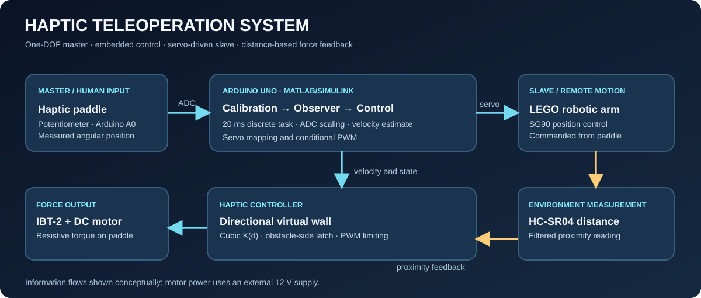
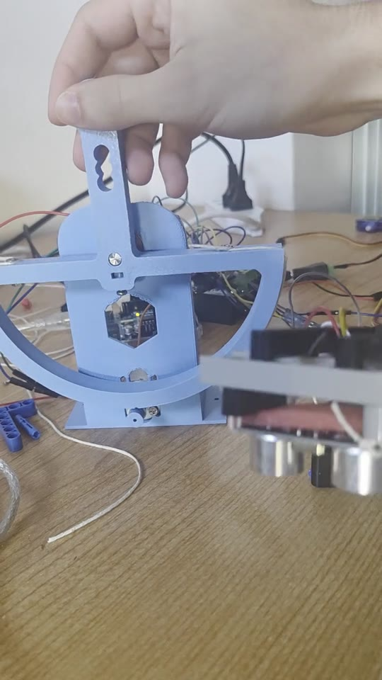
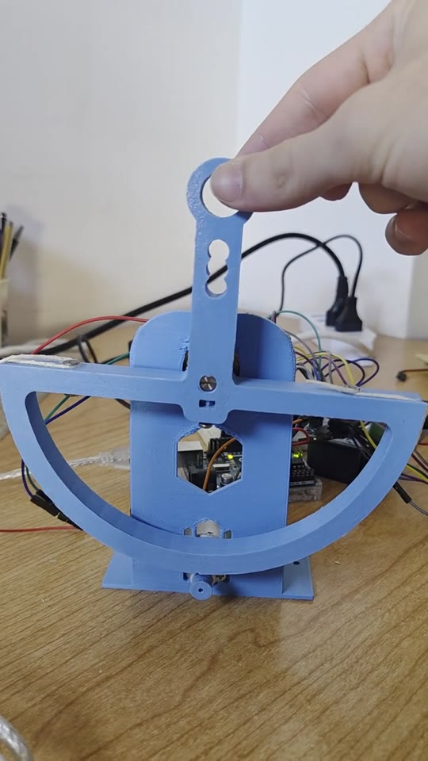
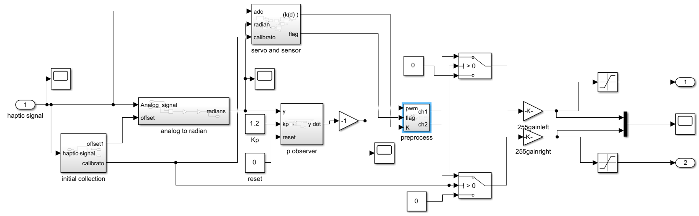

# Haptic Paddle & Sensor-Based Robotic Teleoperation

**Low-cost haptic interface | MATLAB/Simulink | Arduino Uno | Embedded Control | Master–Slave Robotics**

Bachelor's thesis project by **Giovanni Gentiloni Silveri** — B.Sc. in Computer and Control Engineering, Sapienza University of Rome (2026).

> **Project:** Design and implementation of a low-cost haptic paddle and its extension to a master–slave teleoperation demonstrator. This repository documents the experimentally developed system, authentic screenshots of the Simulink subsystems from the thesis, and separate Arduino hardware-test sketches. **The complete executable Simulink `.slx` model is not included yet**; see [What is included](#what-is-included).



## Prototype in action

The short recordings below are **real footage supplied by the author** of the 3D-printed haptic paddle and the experimental master–slave hardware (September 2026). For safer public sharing, the portfolio copies have **audio and phone metadata removed**. They document the mechanical prototype and demonstrations, not calibrated force measurements.

| Hardware / master–slave setup | Paddle motion |
| --- | --- |
| [](media/demo-master-slave.mp4)<br>[Watch master–slave hardware clip (MP4)](media/demo-master-slave.mp4) | [](media/demo-paddle-motion-1.mp4)<br>[Watch paddle motion (MP4)](media/demo-paddle-motion-1.mp4) |

[Additional paddle clip](media/demo-paddle-motion-2.mp4) · [Simulink screenshot gallery](docs/simulink-screenshots.md)


## At a glance

An operator moves a **one-degree-of-freedom haptic paddle** (master). An Arduino-based control system maps that motion to a **LEGO robotic arm driven by an SG90 servo** (slave). An **HC-SR04 ultrasonic sensor** measures proximity to obstacles. As the arm approaches an obstacle, the paddle's DC motor generates increasing, **direction-dependent viscous resistance** so the operator can sense proximity through the interface.

This is **sensor-based haptic feedback**, not direct contact-force measurement. The slave is actuated by a servo position command; the environmental feedback signal comes from measured distance, not from a force/torque sensor. The prototype uses a local Arduino-based setup and should not be described as an Internet/network teleoperation system.

### Engineering contributions

- Rebuilt the original LabVIEW haptic-control pipeline in **MATLAB/Simulink**, using an embedded fixed-step implementation on an **Arduino Uno**.
- Integrated a potentiometer, **IBT-2 (BTS7960)** H-bridge and DC motor to generate velocity-dependent resistive feedback.
- Calibrated ADC readings and tuned a discrete proportional velocity observer to manage noisy sensor data and real actuator dynamics.
- Extended the haptic paddle to a **master–slave robotic setup** with servo-angle mapping and ultrasonic obstacle detection.
- Designed a **cubic distance-dependent virtual wall** and a **directional hysteresis flag** to increase resistance when approaching an obstacle without unnecessarily resisting retreat.
- Addressed hardware limitations, including **ATmega328P memory constraints**, servo jitter, ultrasonic outliers, and inconsistencies between simulation and hardware behavior.

## Hardware

| Component | Role |
| --- | --- |
| Arduino Uno / ATmega328P | Acquisition, embedded execution, PWM and servo control |
| DC motor + IBT-2 H-bridge | Haptic torque generation |
| Potentiometer (A0) | Master-paddle angular position |
| 3D-printed paddle mechanics | Low-cost one-DOF human interface |
| SG90 servo + LEGO arm | Slave motion |
| HC-SR04 ultrasonic sensor | Obstacle distance acquisition |
| External 12 V / 3 A supply | DC motor power stage |

See [hardware connections](docs/hardware-setup.md). The main Simulink task period was **20 ms (50 Hz)**. The servo uses an approximately 50 Hz control pulse train; these are different concepts.

## Control architecture

**1. Master motion and base damping.** Arduino samples the potentiometer, an initialization routine estimates the paddle's zero offset, and the ADC value is scaled to an angular position. A proportional observer estimates angular velocity. The DC motor applies a torque approximately consistent with **viscous damping**:

```text
             tau_base = -b * omega_hat
```

**2. Slave actuation.** Paddle ADC values are mapped to the servo range using **piecewise linear calibration** (500 → 0°, 680 → 120°, 800 → 180°), clamped to [0°,180°], then smoothed by a first-order low-pass filter (`alpha = 0.1`). These values come from the thesis's integrated Simulink mapping, not the earlier standalone Arduino calibration test.

**3. Obstacle-dependent feedback.** Filtered HC-SR04 measurements drive a virtual-wall gain:

```text
K(d) = 0                               if d > 10 cm or d is invalid
     = Kmax                            if d < 2 cm
     = Kmax * ((10 - d) / (10 - 2))^3  otherwise
Kmax = 0.35 (controller gain, not measured force in newtons)
```

A stateful direction flag is acquired when **distance < 5 cm** and its latch is released when **distance > 15 cm**. In the implemented controller the gain is added to the damping of only the appropriate PWM channel, depending on the latched obstacle side. Outside the proximity region, `K(d)=0`, preserving baseline damping.

**4. Robust distance sensing.** The prototype uses a multistage filter: measurement validity [2.5,40] cm, anti-spike threshold 3 cm (accept after three consecutive spikes), low-pass smoothing (`alpha=0.3`) and a 0.1 cm deadband. Note that the filter's minimum valid measurement (2.5 cm) and the wall-law's nominal minimum (2 cm) are different settings; the effective behavior depends on the filtering state.

More detail: [control algorithms and design decisions](docs/control-algorithms.md).

## Simulink implementation — visual walkthrough

All screenshots below are taken from the original thesis PDF, rather than reconstructed MATLAB source files. They document **real Simulink subsystems** and the integration architecture. The underlying `.slx` model is not included.

| Embedded paddle controller | Slave motion and sensing |
| --- | --- |
| [](assets/simulink/arduino-integration.png) | [](assets/simulink/ultrasonic-distance.png) |

| Directional obstacle detection | PWM haptic output logic |
| --- | --- |
| [](assets/simulink/directional-wall.png) | [](assets/simulink/directional-pwm.png) |

**[View all 10 Simulink screenshots and descriptions →](docs/simulink-screenshots.md)**

## Final Simulink model (thesis figure)



*Figure reproduced from the author's bachelor's thesis (Figure 5.1). This screenshot is documentation, **not** a runnable `.slx` file.*

## What is included

```text
.
├── README.md
├── assets/
│   ├── system-architecture.svg
│   ├── final-simulink-model.png
│   ├── simulink/   (10 thesis screenshots)
│   └── *.jpg      (real video stills)
├── docs/
│   ├── control-algorithms.md
│   ├── hardware-setup.md
│   ├── validation-and-limitations.md
│   ├── project-summary-for-cv.md
│   ├── publishing-guide-it.md
│   └── simulink-screenshots.md
├── media/          (3 short demo MP4 clips)
└── software/
    ├── arduino/
    │   ├── paddle_hardware_test/paddle_hardware_test.ino
    │   └── slave_sensor_test/slave_sensor_test.ino
    └── simulink/README.md  (illustrated subsystem walkthrough)
```

The original **Simulink subsystem screenshots** are the documentation of the model implementation: see the [illustrated subsystem walkthrough](software/simulink/README.md) and [thesis screenshot gallery](docs/simulink-screenshots.md). **No reconstructed MATLAB `.m` implementations are published as substitutes for the missing `.slx` model.** Arduino sketches are independent hardware tests from the thesis appendix; neither sketch implements the complete teleoperation pipeline.

## Reproducing the demonstrator

1. Review the [hardware wiring and safety notes](docs/hardware-setup.md) and confirm motor direction/limits before enabling the actuator.
2. Run the standalone Arduino tests separately to check sensors, PWM, and servo motion.
3. In MATLAB/Simulink, install the supported **Simulink Support Package for Arduino Hardware** and configure a discrete fixed-step model at `Ts = 0.02 s`.
4. Rebuild or import the **original complete Simulink model** (not included in this repository at present). Integrate the paddle processing chain, servo reference chain, filtered distance chain and directional PWM logic.
5. Calibrate the paddle zero position, ADC travel range, motor sign and PWM limits on the **actual hardware** before trying haptic feedback. Test with conservative commands first.

**There is no verified one-click reproduction or calibrated physical-force measurement in this package.** The available files document the thesis setup and help understand its logic.

## Results & lessons learned

The thesis reports a functioning low-cost demonstrator with a virtual viscous damper and a **unidirectional proximity wall**. The design iteration also established why two initially attractive approaches were dropped: velocity estimation from distance was too sensitive to ultrasonic noise and delays, and an additional observer raised memory costs on the Uno. A position-based directional latch was used instead.

See [validation and limitations](docs/validation-and-limitations.md) for the distinction between observed behavior and metrics that were *not* measured.

## Prior work and credit

Mechanical inspiration and the starting control architecture: **Auralius Manurung, [Very Low Cost Haptic Paddle](https://github.com/auralius/very-low-cost-haptic-paddle) (2022)**. This thesis project is an adaptation/extension in Simulink and a sensor-based teleoperation application; it is **not** a claim to have originated the underlying paddle concept. Please consult the original project's license before reusing its CAD or source files.

## Project status & licensing

Academic prototype / portfolio documentation. The repository does not yet contain the author's complete `.slx` file or original CAD exports. The images and videos of the real prototype are provided as visual documentation. **No reuse license has been selected for this repository**; publication does not by itself grant permission to reuse the content. See [publishing guide](docs/publishing-guide-it.md).
