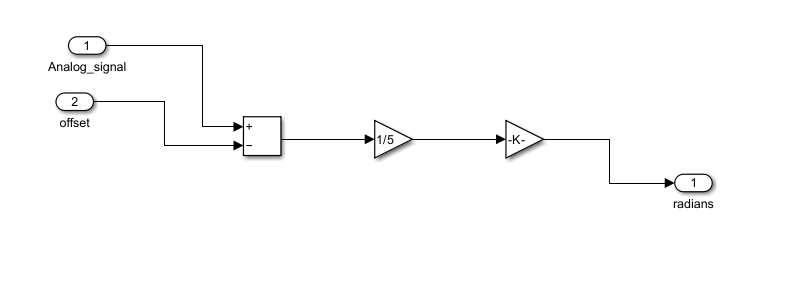
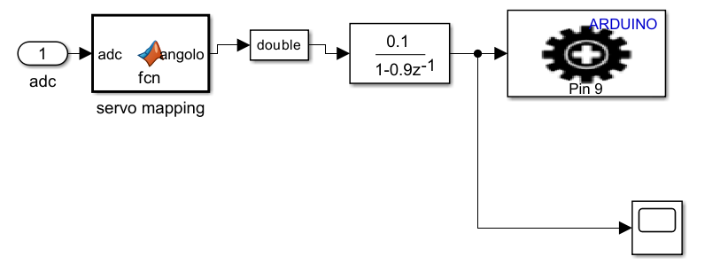
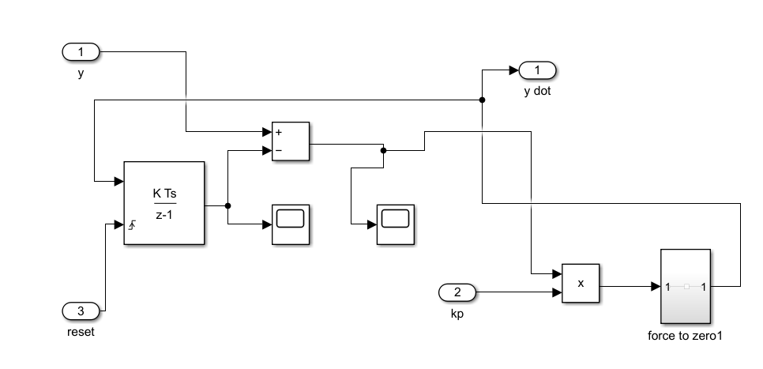
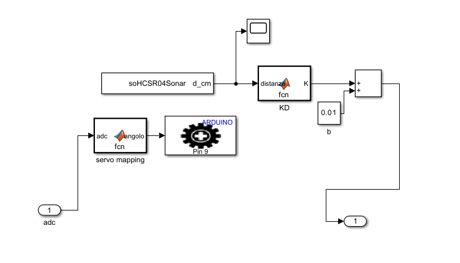
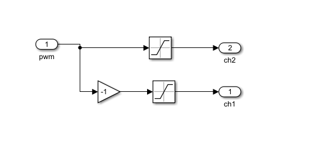
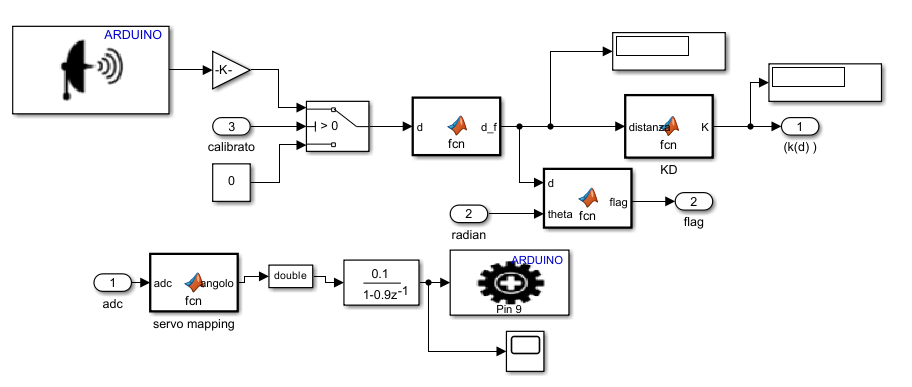
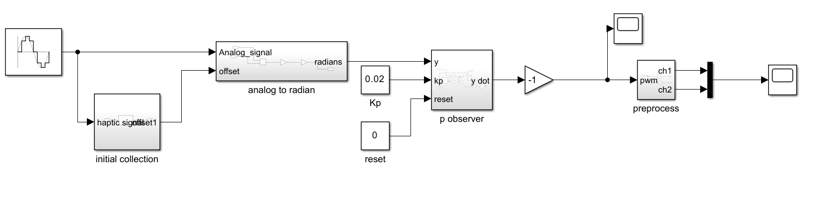
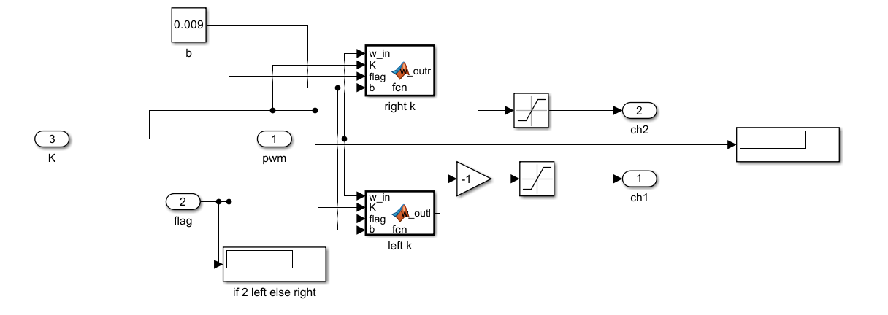
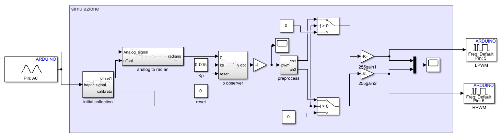

# Simulink model screenshots — from the thesis

These are **authentic screenshots embedded in Giovanni Gentiloni Silveri's bachelor's thesis** (2026). They illustrate the design and development stages. **They are not editable `.slx` models, source code, or proof of plug-and-play reproducibility.** Figure descriptions follow the thesis's technical narrative.

| Processing and embedded control | Master–slave integration |
| --- | --- |
| **ADC → angle (thesis PDF p. 13)**  | **Servo mapping and filtering (p. 59)**  |
| **Angular velocity observer (p. 15)**  | **HC-SR04 sensor chain (p. 61)**  |
| **PWM preprocessing (p. 16)**  | **Directional obstacle logic (p. 66)**  |
| **Original Simulink controller (p. 23)**  | **Direction-selective PWM gains (p. 74)**  |
| **Arduino paddle integration (p. 41)**  | **Final integrated model (p. 78)**  |

**Reading the architecture:** the master paddle is sensed at A0; its angular position drives both the damping controller and the servo reference. The slave servo is commanded through pin D9. The HC-SR04's distance measurement enters a filtered proximity-feedback channel; a latched directional flag controls which PWM branch receives additional damping.

For a detailed explanation of the model's design, see [Control algorithms](control-algorithms.md). The source `.slx` project remains to be added by the author.
